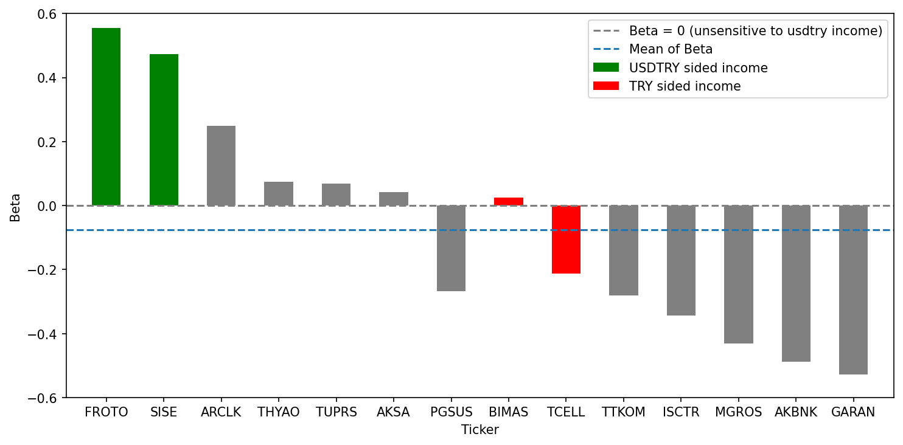
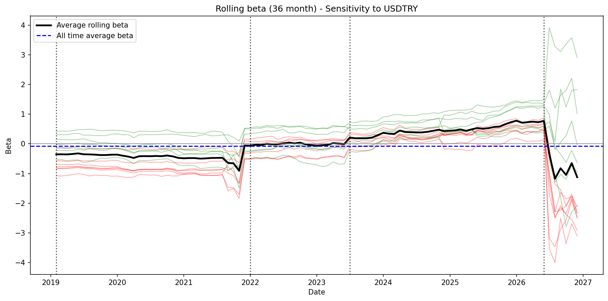

# bist-currency-beta
Do FX-linked revenues protect Turkish equities from lira depreciation? Pre-registered study of 14 BIST stocks, 2016–2026.
<h1 align="center">Currency Sensitivity of BIST Equities</h1>

<p align="center">
  <em>Does dollar-linked revenue actually protect Turkish shareholders from lira depreciation?</em>
</p>

<p align="center">
  
  
  
  
</p>

---

Partially, and much less than the label suggests. Companies with FX-linked revenue do have systematically higher currency betas than domestically-oriented ones. But no company in the sample comes close to a beta of 1, and measured in dollars **every stock here loses value when the lira falls.** The only question is how much.



## TL;DR

- **FX-linked companies have higher currency betas than domestic ones**  0.17 vs −0.32 on average (Welch *t* = 3.85, *p* = 0.003).
- **Nobody is hedged.** Implied dollar betas run from −0.44 (FROTO) to −1.53 (GARAN). Not one is positive.
- **Domestic names are worse than unhedged.** A dollar beta of −1.5 means a 1% lira decline costs 1.5% in dollar terms.
- **All four pre-registered exceptions materialised**, including PGSUS landing among the domestic names despite euro revenue.
- **HAC standard errors remove most individual significance.** Only 2 of 14 stocks survive at *p* < 0.05. The supportable claim is group-level, not stock-level.

---

## Hypothesis

> Companies whose revenue is linked to foreign currency have TRY returns that are more sensitive to exchange-rate moves; their currency beta is meaningfully higher than that of companies serving the domestic market.

Written and committed **before** any regression was run — see commit history.

<details>
<summary><b>Pre-registered exceptions</b> (click to expand)</summary>

<br>

The grouping is imperfect. These four deviations were predicted in advance:

1. **THYAO and PGSUS**  airlines earn in hard currency but also carry FX-denominated costs (fuel, aircraft leases) and FX debt. Net exposure cannot be read off the revenue mix.
2. **Banks (AKBNK, GARAN, ISCTR)**  FX positions are subject to regulatory limits, and in Turkey a currency shock typically arrives with a rate hike. Bank response is driven by monetary policy, not revenue currency. These are arguably a third category.
3. **TCELL and TTKOM**  TRY revenue, but FX-denominated debt and equipment costs. Negative beta plausible.
4. **TUPRS**  domestic sales with dollar-linked pricing. A borderline case, assigned to the FX-linked group and left there.

All four held.

</details>

---

## Universe

Fourteen large, liquid companies continuously traded since January 2016. **This is a defined basket, not an index.** Index membership was deliberately avoided: historical BIST-30 composition cannot be reconstructed from public data, and applying today's membership to a ten-year window would build survivorship bias into the universe definition itself.

<details>
<summary><b>Company list and group rationale</b> (click to expand)</summary>

<br>

| Company | Group | Rationale |
| :--- | :--- | :--- |
| THYAO | FX-linked | Reports revenue in USD |
| PGSUS | FX-linked | Reports revenue in EUR |
| FROTO | FX-linked | Exports ≈ 84% of revenue |
| ARCLK | FX-linked | International sales ≈ 65% |
| SISE | FX-linked | International sales ≈ 59–61% |
| TUPRS | FX-linked | Domestic sales, dollar-linked pricing |
| AKSA | FX-linked | Exports ≈ 64%, reports in USD |
| BIMAS | Domestic | Retail, TRY revenue |
| MGROS | Domestic | Retail, TRY revenue |
| TCELL | Domestic | Telecom, TRY revenue |
| TTKOM | Domestic | Telecom, TRY revenue |
| AKBNK | Domestic | Bank |
| GARAN | Domestic | Bank |
| ISCTR | Domestic | Bank |

</details>

---

## Method

Monthly log returns, February 2016 – November 2026 (*n* = 130 per stock). For each company, TRY return is regressed on the log change in USD/TRY:

```
r_TRY = α + β · f + ε
```

Fitted twice, standard OLS, and Newey-West (HAC) standard errors at 4 lags. HAC leaves coefficients unchanged and corrects the standard errors for heteroskedasticity and autocorrelation in the residuals.

### Reading beta in dollar terms

Log returns decompose exactly as `r_TRY = r_USD + f`, so the regression satisfies:

```
β_TRY = 1 + β_USD
```

A TRY beta of 0.30 is a dollar beta of −0.70: when the lira falls 1%, the stock loses 0.70% of its value in dollars. A beta of 1.0 would mean full insulation. The identity was verified numerically, residual on the order of `1e-16`.

---

## Results

| Ticker | Group | β (TRY) | β (USD) | *p* (OLS) | *p* (HAC) | α (monthly) | R² |
| :--- | :--- | ---: | ---: | ---: | ---: | ---: | ---: |
| FROTO | FX-linked | **0.555** | −0.445 | 0.001 | **0.000** | 0.017 | 0.080 |
| SISE | FX-linked | **0.474** | −0.526 | 0.004 | **0.014** | 0.012 | 0.062 |
| ARCLK | FX-linked | 0.248 | −0.752 | 0.153 | 0.281 | 0.008 | 0.016 |
| THYAO | FX-linked | 0.074 | −0.926 | 0.722 | 0.750 | 0.027 | 0.001 |
| TUPRS | FX-linked | 0.069 | −0.931 | 0.713 | 0.625 | 0.032 | 0.001 |
| AKSA | FX-linked | 0.042 | −0.958 | 0.822 | 0.834 | 0.028 | 0.000 |
| BIMAS | Domestic | 0.025 | −0.975 | 0.854 | 0.839 | 0.028 | 0.000 |
| TCELL | Domestic | −0.213 | −1.213 | 0.173 | 0.379 | 0.025 | 0.014 |
| PGSUS | FX-linked | −0.268 | −1.268 | 0.279 | 0.378 | 0.035 | 0.009 |
| TTKOM | Domestic | −0.280 | −1.280 | 0.131 | 0.406 | 0.025 | 0.018 |
| ISCTR | Domestic | −0.343 | −1.343 | 0.085 | 0.206 | 0.031 | 0.023 |
| MGROS | Domestic | −0.431 | −1.431 | 0.022 | 0.210 | 0.036 | 0.040 |
| AKBNK | Domestic | −0.488 | −1.488 | 0.014 | 0.091 | 0.032 | 0.046 |
| GARAN | Domestic | −0.527 | −1.527 | 0.007 | **0.058** | 0.037 | 0.055 |

### 1 · The group difference holds

| Group | Mean β | Median β | SD | n |
| :--- | ---: | ---: | ---: | ---: |
| FX-linked | 0.171 | 0.074 | 0.281 | 7 |
| Domestic | −0.323 | −0.343 | 0.190 | 7 |

Welch two-sample *t*-test: **t = 3.85, p = 0.003**, df = 10.5.

### 2 · Nobody is hedged

Implied dollar betas run from −0.44 to −1.53. Not one company has a positive dollar beta. Dollar-linked revenue does not turn currency depreciation into a gain; at best it halves the loss.

Domestic companies are *worse* than unhedged. For the three banks this is consistent with the policy channel: currency stress arrives together with rate hikes and foreign outflows.

### 3 · All four pre-registered exceptions materialised

| Prediction | Observed |
| :--- | :--- |
| Airlines will not behave like exporters | THYAO 0.07 (insignificant); PGSUS −0.27, sitting among domestic names |
| Banks will be strongly negative | ISCTR −0.34, AKBNK −0.49, GARAN −0.53 — the three lowest in the sample |
| Telecoms may be negative despite TRY revenue | TCELL −0.21, TTKOM −0.28 |
| TUPRS is a borderline case | 0.07, statistically indistinguishable from zero |

### 4 · HAC removes most individual significance

Under OLS, six stocks clear *p* < 0.05. Under HAC, only two do: FROTO (0.000) and SISE (0.014). GARAN (0.058) and AKBNK (0.091) are marginal; the remaining ten are indistinguishable from zero.

MGROS moves from 0.022 → 0.210 and AKBNK from 0.014 → 0.091. The OLS *p*-values were systematically overstating the evidence.

> [!IMPORTANT]
> The claim this analysis supports is a **group-level** one. Individual betas outside FROTO and SISE should not be quoted as findings.

---

## Is the sensitivity stable over time?

36-month rolling beta for all fourteen companies, coloured by group, with major currency-shock dates marked.



<!-- TODO: one or two sentences reading this chart.
     Do the two groups separate throughout, or only around shocks?
     Does the spread widen in 2018 / 2021 / 2023? -->

---

## Robustness

FROTO and SISE have the two largest betas and carry the most statistical weight. Dropping both and recomputing:

| Group | Mean β (full) | Mean β (excl. FROTO, SISE) |
| :--- | ---: | ---: |
| FX-linked | 0.171 | 0.033 |
| Domestic | −0.323 | −0.323 |

The gap narrows from 0.49 to 0.36 but does not disappear. The group difference is not an artefact of two outliers.

---

## Limitations

<details open>
<summary><b>Five things this analysis does not establish</b></summary>

<br>
**No market control.** The specification is univariate. BIST-100 itself has a negative currency beta, so each stock's measured beta partly reflects its market beta times the market's FX beta. The banks' strongly negative betas may in part be a high-market-beta effect rather than currency exposure as such. A two-factor specification is the natural next step.

**Revenue mix is measured today, applied to ten years.** FROTO's export share in 2016 was not its share in 2026. The group assignment is static; the underlying exposure was not.

**Low power at the group level.** Seven observations per group. The *t*-test treats each beta as a single number and ignores its own estimation uncertainty. The result is an indication, not proof.

**No causal claim.** The exchange rate and equity prices are jointly determined by common macro shocks. Beta measures co-movement, not the effect of currency on prices.

**Alphas are nominal.** The intercepts (0.8%–3.7% monthly) are FX-neutral returns, neither risk-adjusted nor inflation-adjusted. In a high-inflation economy a positive nominal alpha is not evidence of outperformance.

</details>

---

## Reproducing

```bash
pip install pandas numpy yfinance statsmodels matplotlib scipy
jupyter notebook projeclaude.ipynb
```

Run top to bottom. Raw prices are cached to `raw_data.parquet` on first run; subsequent runs read from disk so results stay reproducible as new data arrives.

```
.
├── bist-currency-beta.ipynb      # full analysis
├── HYPOTHESIS.md          # pre-registered hypothesis and expected exceptions
├── raw_data.parquet       # cached daily prices, 2016–2026
├── sonuc.csv              # regression results table
└── figures/
    ├── beta_ranked.png    # betas sorted, coloured by group
    └── rolling_beta.png   # 36-month rolling beta with shock dates
```

---

<p align="center">
  <sub>Metehan Çiftçi · Hacettepe University, Economics</sub>
</p>
